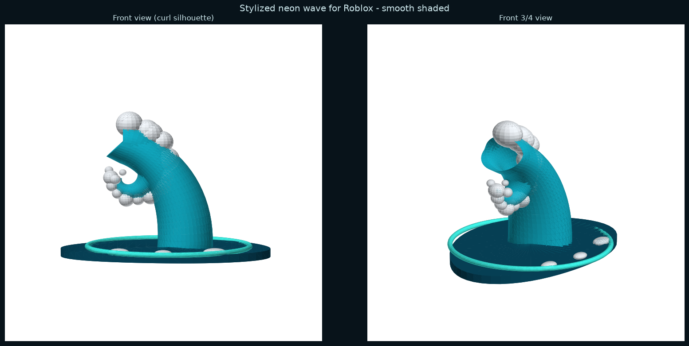

# Stylized Neon Wave — 3D-модель для Roblox

Декоративная стилизованная океанская волна в мультяшном «неоновом» стиле:
крутящийся гребень с пенными воланами, тёмная лужа воды у основания и
светящееся неоновое кольцо. Гладкое затенение, ~8 900 вершин, ~16 100 треугольников.
Сгенерирована процедурно скриптом `generate_wave.py` (чистые NumPy + стандартная библиотека).



## Состав модели

Размеры в студах (1 юнит = 1 студ), модель стоит на нулевой плоскости, «лицо» волны смотрит на +Z.

| Группа в OBJ  | Материал (MTL) | Описание                                      |
|---------------|----------------|-----------------------------------------------|
| `WaveBody`    | `WaveBody`     | Тело волны (стена + спиральный гребень)       |
| `FoamCrest`   | `Foam`         | Пенные воланы вдоль внешнего края гребня      |
| `FoamStreak`  | `Foam`         | Брызги пены на воде перед волной              |
| `PuddleSide` / `PuddleCap` | `Puddle` | Лужа воды под волной             |
| `NeonRing`    | `NeonRing`     | Тонкое неоновое кольцо вокруг лужи             |

Общие габариты: **11.7 × 8.0 × 9.4 студов** (ширина × высота × глубина).

## Как импортировать в Roblox Studio

1. Откройте Studio → вкладка **Home** → **Import 3D** (или **Asset Manager → импорт**).
2. Выберите файл `wave/neon_wave.obj`. В появившемся окне импорта включите
   внешний вид сетки (это не обязательно) и нажмите **Import**.
3. MTL Studio не применяет как «готовые» материалы — вместо этого после импорта
   назначьте материалы и цвета сами (модель разобъётся на части по группам OBJ):
   - `WaveBody` → Material: **Neon** (свечение) или **SmoothPlastic**, цвет бирюзовый (#12B8D1-ish)
   - `Foam` → Material: **SmoothPlastic**, цвет белый
   - `Puddle` → Material: **Glass** или **SmoothPlastic**, тёмно-бирюзовый
   - `NeonRing` → Material: **Neon**, цвет #40FFF2
4. Модель можно масштабировать через `Model.ScaleTo()` или обычным Scale в Studio.
   Базовый размер рассчитан на декоративную волну ~8 студов высотой.
5. Для анимации «дыхания» волны можно повесить скрипт, плавно скейлящий `WaveBody`
   по Y (например, `sin(t) * 0.05 + 1`), или анимировать кольцо через `NeonRing.Beam`-эффекты.

> Примечание: Roblox официально предпочитает glTF/FBX для точного переноса материалов.
> Здесь геометрия + текстуры цветов заданы группами `usemtl`, что надёжно импортируется
> из OBJ; цвета/материалы при желании можно переназначить в один клик в Studio.

## Как пересобрать модель

```bash
python3 -m venv .venv
.venv/bin/pip install numpy matplotlib
.venv/bin/python generate_wave.py
```

Скрипт перезаписывает `neon_wave.obj`, `neon_wave.mtl` и `preview.png`.
Параметры формы (кривизна гребня, радиусы пены, ширина лужи и т.д.) вынесены
в константы и секции `build_*` — можно подкрутить под свой стиль.

## Файлы

- `neon_wave.obj` — геометрия (группы, `vn`-нормали, сглаживание `s 1`)
- `neon_wave.mtl` — цвета/блики материалов
- `generate_wave.py` — процедурный генератор
- `preview.png` — рендер-превью (front + 3/4)
